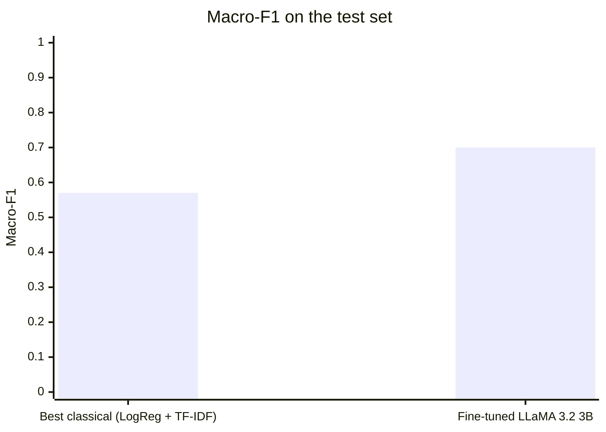
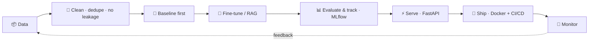

<!-- Profile README — repo: mostafaelmehi/mostafaelmehi (upload banner.svg next to this file) -->

<div align="center">



<a href="https://www.linkedin.com/in/Moustafa-Elmehy"></a>
<a href="mailto:mostafa94955@gmail.com"></a>


<br/><br/>

<a href="https://git.io/typing-svg"></a>

</div>

---

## 🧠 About me

```python
class MoustafaElmehy:
    role       = "AI Engineer · NLP & LLM applications"
    based_in   = "Dortmund, Germany 🇩🇪"
    education  = "B.Sc. Informatik (Data Science) @ FH Dortmund — 2026, thesis graded 1.5"
    work       = "Data Trust Analyst (working student) @ TELUS International — evaluating AI-generated output"
    focus      = ["LLM fine-tuning", "RAG & AI agents", "honest model evaluation", "MLOps"]
    principles = ["dedupe before you split", "no data leakage", "simple model first", "measure, don't guess"]
    speaks     = {"Arabic": "native", "German": "C1", "English": "B2"}
```

---

## 🛠️ Tech stack

<div align="center">

| | |
|:--|:--|
| **Languages** |  |
| **ML & LLMs** |    |
| **RAG & Agents** |    |
| **MLOps & Cloud** |   |
| **Analytics** |    |

</div>

---

## 🚀 Featured work
> Click a project to expand it.

<details open>
<summary><b>🎓 From Bag-of-Words to Specialized LLMs</b> — IT support ticket classification <i>(Bachelor thesis · 2026)</i></summary>
<br/>

**Problem:** route support tickets automatically to one of **10 departments**, and find out whether a fine-tuned LLM really beats classical NLP.

**What I did**
- Cleaned **29,651** tickets → **25,222** after removing **4,428 exact duplicates** *before* splitting, so no ticket leaks from train into test
- Benchmarked 4 classical pipelines: Naive Bayes (BoW / TF-IDF), Logistic Regression (TF-IDF), Random Forest (Word2Vec)
- Fine-tuned **LLaMA 3.2 3B** with **QLoRA**, comparing staged vs. single-run training and LoRA ranks r ∈ {8, 16}

**Result**



The LLM wins on quality; Logistic Regression stays the pragmatic choice when compute is tight.

`PyTorch` `Hugging Face` `QLoRA` `scikit-learn` `NLP`
</details>

<details>
<summary><b>⚽ Expected Assists in pro football</b> — interpretable ML + MLOps pipeline</summary>
<br/>

**Question:** can a player's expected-assist value be explained from performance data?

- Player data from Europe's **top 5 leagues**; removed leakage-prone variables and players under 270 minutes
- Selected **33 of 260+ features** via Mutual Information + Sequential Forward Selection with cross-validation
- The simpler **linear model beat Random Forest** — **R² = 0.917** on test data; key drivers: key passes & passes into the box
- Wrapped as a service with **FastAPI**, experiment tracking in **MLflow**, packaged with **Docker**

`Python` `scikit-learn` `FastAPI` `MLflow` `Docker`
→ [**View repo**](https://github.com/mostafaelmehi/xa-expected)
</details>

<details>
<summary><b>🧩 Solving photographed crosswords with AI</b> — vision + LLM pipeline</summary>
<br/>

- Pipeline that aligns the photo, detects the grid and answer fields, and structures clues by direction and length
- **GPT via the OpenAI API** for text recognition and answer suggestions, plus an external reference source
- LLM answers **validated by rules** (word length + crossing letters), so only consistent answers make it into the solution

`Python` `OpenAI API` `Computer Vision` `LLM validation`
</details>

<details>
<summary><b>☕ Starbucks customer analysis</b> — CRISP-DM + Power BI</summary>
<br/>

- Full analysis notebook: survey cleaning, multi-answer encoding, customer segmentation, preferences & marketing channels
- Separate **Power BI dashboard** for purchase and satisfaction patterns
- Derived marketing and assortment recommendations to grow revenue and reduce food waste

`Python` `Pandas` `Power BI` `CRISP-DM`
→ [**View repo**](https://github.com/mostafaelmehi/starbucks-full-project)
</details>

<details>
<summary><b>🏀 More projects</b></summary>
<br/>

- [NBA player salaries](https://github.com/mostafaelmehi/ML-project-NBA-Player-Salaries-) — ML regression on player stats
- [Football analysis in R](https://github.com/mostafaelmehi/football-5th-sms) — statistical analysis
- [Data analysis lab](https://github.com/mostafaelmehi/praktikum2) — university data-analysis task
</details>

---

## 🔁 How I take a model from idea to production



---

## 📊 GitHub activity

<div align="center">


</div>

---

<div align="center">

### 🤝 Open to AI Engineer, ML Engineer & AI Consultant roles

<i>"I don't just build models — I check whether they're actually better."</i>

<a href="https://www.linkedin.com/in/Moustafa-Elmehy"></a>

</div>
